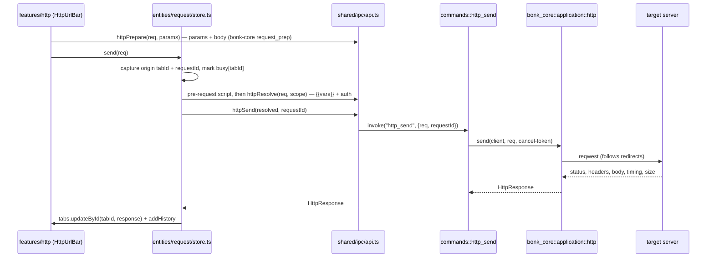

# Architecture

Bonk is a local-first desktop API client (HTTP + gRPC). It is split into three
layers with a deliberately thin boundary between them:

- **`src/`** — Svelte 5 UI (view + thin view-state).
- **`src-tauri/`** — Tauri shell: `#[tauri::command]` wrappers grouped per area in
  `commands/` (`http`, `grpc`, `workspace`, `git`, `terminal`, `secrets`, `mcp`, `app`),
  app state, native dialogs. Owns no business logic.
- **`crates/bonk-core/`** — Tauri-independent Rust core: all HTTP/gRPC/workspace/
  state logic. Buildable and testable without a webview (`cargo test -p bonk-core`).
  `domain/request_prep.rs` turns a request into what goes on the wire (params, body,
  `{{vars}}`, auth, folder-auth inheritance); the app (`http_prepare` / `http_resolve`)
  and bonk-mcp both send through it.
- **`crates/bonk-mcp/`** — headless Model Context Protocol server. Reuses
  `bonk-core` and exposes workspace resources/tools over STDIO or Streamable HTTP.
  `server.rs` holds the MCP surface, `runtime.rs` the `BonkRuntime` operations, and
  helpers live in `vars.rs` (app env/globals + keychain), `request_prep.rs`
  (HTTP client, target-host policy), `scripts.rs`, and `redact.rs` (secret scrubbing).

```
┌─────────────────────────────────────────────────────────────────┐
│  src/  — Svelte 5 (WKWebView)                                     │
│                                                                   │
│  app/App.svelte ── features/ ── entities/ (tab, workspace, …)     │
│       │                              │                            │
│       │            shared/ipc/api.ts, shared/persist/persist.ts   │
│       │            (invoke wrappers)                              │
│       │            shared/model: types, http, vars, curl          │
└───────┼───────────────────────────────────────────────────────────┘
        │  Tauri IPC  (invoke "command", JSON args/results)
┌───────▼───────────────────────────────────────────────────────────┐
│  src-tauri/  — Tauri shell (thin)                                  │
│                                                                    │
│  commands/<area>.rs  #[tauri::command] fns → call bonk_core        │
│  state.rs          AppState { http_client, conns, cancels }        │
│  lib.rs            Builder + generate_handler!  ·  pick_folder(rfd) │
└───────┬───────────────────────────────────────────────────────────┘
        │  plain Rust calls (bonk_core::…)
┌───────▼───────────────────────────────────────────────────────────┐
│  crates/bonk-core/  — pure core (no tauri, no rfd)                 │
│                                                                    │
│  application/  http · grpc_native · workspace · app_state          │
│  domain/       http · grpc · grpc_parse · url · workspace (types)  │
│  infra/        reqwest_client                                      │
│  conn.rs       GrpcConn, GrpcDescriptorCache                       │
└───────┬───────────────────────────────┬───────────────────────────┘
        │ reqwest / tonic                │ std::fs
┌───────▼────────────┐         ┌─────────▼─────────────────────────┐
│ HTTP / gRPC servers │         │ Disk: workspace folder + state.json│
└────────────────────┘         └───────────────────────────────────┘
```

`bonk-mcp` is a sibling frontend to Tauri rather than part of the desktop
process. Local AI clients spawn it over STDIO. Remote clients connect to its
single `/mcp` Streamable HTTP endpoint. In both modes it receives one canonical
workspace root at startup and delegates request persistence and protocol work to
`bonk-core`. Desktop bundles include it as a Tauri sidecar;
`bonk-core/src/application/mcp_install.rs` copies that sidecar to a stable per-user path and safely adds/removes the `bonk`
entry in supported local client configurations.

## Tauri commands (the IPC surface)

`src-tauri/src/lib.rs` registers these groups. Most commands are thin wrappers
over `bonk-core`; folder/file dialogs are shell-owned:

| Area | Commands |
| --- | --- |
| HTTP | `http_send`, `cancel_request` |
| gRPC | `grpc_connect`, `grpc_reflect`, `grpc_template`, `grpc_call` |
| Workspace | `workspace_pick_folder`, `workspace_load`, `workspace_create_folder`, `workspace_save_request`, `workspace_rename`, `workspace_delete`, `workspace_duplicate`, `workspace_move` |
| App state | `app_state_load`, `app_state_set` |
| MCP integration | `mcp_integration_status`, `mcp_install`, `mcp_uninstall` |

Frontend bindings live in `src/shared/ipc/api.ts` (workspace/http/gRPC) and
`src/shared/persist/persist.ts` (app state). The table lists the core commands; the full set
(git, terminal, secrets, OpenAPI, proto, etc.) is the `generate_handler!` list in
`src-tauri/src/lib.rs`.

## Frontend layout (`src/`)

Four layers, one folder per slice (`src/<layer>/<slice>/`). Imports only go down; the rules
are enforced by `src/architecture.test.ts`. Path aliases: `$shared`, `$entities`, `$features`.

| Layer | Holds | Rule |
| --- | --- | --- |
| `app/` | the shell: `App.svelte` (composition root) + `AppSidebar` / `AppMain` / `AppOverlays`, toolbar, tab bar, status bar; `shell.svelte.ts` (menus, dialogs, toast), `layout.svelte.ts` (panes), `actions.ts`, `hotkeys.ts`, `lifecycle.svelte.ts` (`startApp()`: hydrate, watchers, appearance), `persistence.svelte.ts` (restore + save `state.json`), `secrets.ts` | may import everything; only `main.ts` imports it |
| `features/` | user capabilities: `http`, `grpc`, `response`, `codegen`, `sidebar`, `environments`, `runner`, `flow`, `git`, `settings`, `command-palette`, `utility-panel`, `workspace-menu`, `updater`, `import`, `tabs` | never import each other |
| `entities/` | core models and their state (`store.svelte.ts` + pure logic): `tab`, `environment`, `workspace`, `history`, `request`, `flow`, `git` | may import each other, never in a cycle |
| `shared/` | foundation: `persist`, `i18n`, `model` (types + pure request model: http, vars, curl, scripts), `ipc` (`api.ts`), `settings`, `ui`, `editor`, `updater` | no tab/workspace/request state |

A slice's public API is its `index.ts` (code) and `components.ts` (Svelte components); other
slices import only those, never deep paths. Tests sit next to the module they cover
(`foo.ts` → `foo.test.ts`). Global CSS is `src/styles/`: one entry `index.css` (import order = cascade order), design tokens in `tokens.css`, one file per UI area; `settings.css` is imported by `SettingsModal.svelte`.

State is Svelte 5 runes in `*.svelte.ts` modules: each is a class (fields `$state` /
`$state.raw` / `$derived`, plus methods) exported as one instance, e.g. `tabs.list`,
`workspace.tree`, `environments.active`. `app/persistence.svelte.ts` restores it at startup and
then saves each `state.json` key from one `$effect.root`; docs/GUIDE.md «Состояние (руны)» has
the conventions.

## HTTP request flow



- In-flight state is **per tab** (`requestRuntime.busy[tabId]`); the response is written back to
  the tab it was sent from, even if the user switched tabs.
- Cancel: `cancel_request` resolves a `oneshot` in `AppState.cancels`, aborting
  the in-flight reqwest.

## gRPC flow

`grpc_connect` opens a tonic channel (cached in `AppState.conns` keyed by a
connection id) → `grpc_reflect` pulls the service tree via server reflection →
`grpc_template` builds an example JSON message for a method → `grpc_call` invokes
it with metadata. Reflection descriptors are cached in `GrpcDescriptorCache`.
Runtime-only fields (`connectionId`, `tree`) are stripped before a request is
persisted, so a stale connection can't block reconnect after restart.

## Persistence — two stores, both owned by Rust

**1. Workspace = filesystem-as-truth.** When a workspace folder is open, the
directory tree *is* the data:

```
my-workspace/
├── Auth/                     ← folder  (FolderNode, id "fs:Auth")
│   ├── Login.bonk.json       ← request (RequestNode, id "fs:Auth/Login.bonk.json")
│   └── Refresh.bonk.json
└── Health.bonk.json
```

`workspace_load` walks it recursively into a `TreeNode[]` (folders first, then
requests, each alphabetical). Mutations are granular fs ops
(create/save/rename/delete/duplicate/move) — there is **no manifest**, which is
what keeps it Git-friendly and self-healing. Node id = `fs:<relative path>`.

**2. App state = `state.json` KV** (in the app data dir), via `app_state_load` /
`app_state_set`. Holds session/UI state: open `tabs`, `history`, `workspacePath`,
and settings (`historyLimit`, `historyPaused`, `sidebarWidth`, `responseHeight`).
Writes are atomic (temp file + rename) and serialized by a process-wide lock;
a corrupt file degrades to empty instead of wedging. One-time migration reads the
legacy `bonk.json` (old `@tauri-apps/plugin-store` file) if `state.json` is absent.

## Core data types

- **`TreeNode = FolderNode | RequestNode`** (`domain/workspace.rs`, mirrored in
  `src/shared/model/types.ts`) — discriminated by `kind`. On disk a request is a
  `RequestFile` (no id/kind; name is authoritative, filename is derived).
- **`Tab`** (`src/shared/model/types.ts`) — a frontend session tab: protocol, the
  live `HttpRequest`/`GrpcTabState`, optional `savedPath` linking it to a file,
  and the last `response`. Never persisted to the workspace; only to `state.json`.

## Why this shape

- **Core is independent.** `bonk-core` has no `tauri`/`rfd` dep, so the logic is
  unit-testable headless and reusable (a CLI or another frontend could link it).
- **Shell is thin.** `src-tauri` only marshals IPC and owns runtime handles
  (reqwest client, gRPC connections, cancel channels).
- **View is replaceable.** Svelte holds presentation + view-state; all I/O,
  persistence, and protocol logic live behind the command boundary in Rust.
